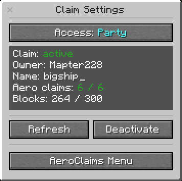
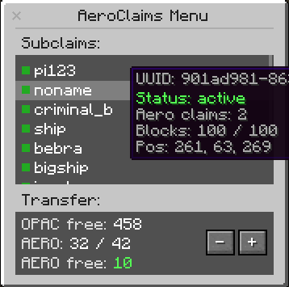

# Aeronautics Claims

Sub-level claim system for Create: Aeronautics.

## Compatibility

Works with:

* Open Parties and Claims (OPAC)
* FTB Chunks / FTB Teams

## About

Aeronautics Claims provides a custom claim system for Create: Aeronautics sub-levels.

The mod is separate from OPAC and FTB Chunks, but integrates with them to synchronize ownership and permissions between regular claims and Aeronautics sub-level claims.

## Commands

### Player Commands
* `/aeroclaims menu` — Open the sub-level management interface.
* `/aeroclaims info` — Show info about your claimed sub-levels and slot limits.
* `/aeroclaims tp <shipUuid>` — Teleport to your claimed sub-level (if enabled in config).

### Admin Commands
* `/aeroclaims info <player>` — View sub-level claim info for a specific player.
* `/aeroclaims sublevels unclaim <shipUuid>` — Unclaim a sub-level by UUID, returning claim and forceload slots to the owner.
* `/aeroclaims sublevels teleport <shipUuid>` — Teleport to any sub-level by UUID.
* `/aeroclaims sublevels repair claim-blocks` — Inspect sub-levels and restore missing or mismatched claim blocks.
* `/aeroclaims sublevels repair phantoms check` — Find phantom claims whose sub-levels no longer exist.
* `/aeroclaims sublevels repair phantoms clear` — Safely purge verified phantom claims and return slots to owners.
* `/aeroclaims sublevels refresh (all | player <player> | sublevel <shipUuid>)` — Recount ship blocks and refresh claim borders.
* `/aeroclaims sublevels delete unclaimed confirm` — Delete all unclaimed sub-levels from the world (requires `enableClearCommand` in config).
* `/aeroclaims sublevels dump` — Export debug data about registered sub-levels to `world/aeroclaims/`.
